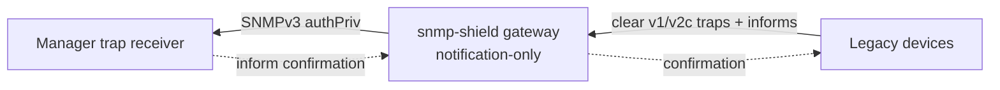

# USM gateway, notification-only (one box, protects the manager leg)

A deployment shape of [gateway-usm](gateway-usm.md): a single proxy in
front of the **manager**. Legacy devices keep firing clear traps/informs
at "the manager" (the proxy); the proxy wraps each into an authenticated
SNMPv3 USM notification toward the manager's real trap receiver. Informs
are confirmed end-to-end: the manager's acknowledgment flows back through
the proxy to the device.



Use when the devices are too old for v3 but the manager side must only
accept authenticated notifications (audited networks, segmented
management VLANs). This is plain usm-gateway with only the notification
legs configured — no request path (no `--listen`/`--agent`).

## 1. Run it

```bash
snmp-shield gateway \
  --security usm-gateway \
  --trap-listen :162 \
  --trap-sink <manager-ip>:162 \
  --auth-pass myauthpass --priv-pass myprivpass
```

- `--trap-listen` — what the devices fire at (the proxy's clear leg).
- `--trap-sink` — the manager's v3 USM trap receiver. The proxy wraps
  every clear trap/inform into an authenticated v3 notification (its own
  authoritative engine, user `proxy`, SHA auth + AES privacy) and sends
  it here.
- `--auth-pass`/`--priv-pass` — the USM credentials the manager's
  receiver is configured to accept.

## 2. Point the devices at the proxy

Devices fire at the proxy's `--trap-listen` instead of the manager.
Informs work end-to-end: the manager's confirmation flows back through
the proxy to the device.

## 3. Verify

```bash
# device-reachability check from the proxy box:
snmp-shield selftest --role gateway --security usm-gateway \
  --trap-listen :162 --trap-sink <manager-ip>:162 \
  --auth-pass myauthpass --priv-pass myprivpass --probe=false
```

(Notification-only usm-gateway has no request path — it secures
notifications only, so there is no agent to probe. The selftest
validates config + engine store.)

## Watch the manager receive

Fire a test trap from any device (or a fake one) at the proxy:

```bash
snmptrap -v 2c -c public <proxy-ip>:162 '' 1.3.6.1.6.3.1.1.5.1
```

The manager's v3 trap receiver sees the same notification, wrapped in
SNMPv3 USM authPriv (user `proxy`). If the manager's receiver supports
informs, an inform-based device gets its acknowledgment back through the
proxy automatically.

## Hardening option

- **Notification filtering** — the natural place for it: drop the
  uninteresting device traps at the clear ingress, so only the ones
  that matter are wrapped into authenticated v3 toward the manager:

  ```bash
  snmp-shield gateway --security usm-gateway --trap-listen :162 \
    --filter-oid 1.3.6.1.4.1.99 --filter-action deny ...
  ```

  `--filter-oid` is an OID prefix (repeatable, arc-boundary match),
  `--filter-action` is `allow` or `deny`. In YAML:
  `notifications.filter` (see `configs/gateway-notifications-only.yaml`).

- **SNMP metrics interface** — expose the proxy's own health over SNMP
  (optional, all roles): `--metrics-snmp-listen <ip:port>` serves a
  read-only SNMPv2c health MIB (GET/GETNEXT: identity, tunnel state,
  counters) and `--metrics-snmp-trap-sink <ip:port>` emits v2c traps on
  tunnel lifecycle changes (up/down, HA failover). `--metrics-snmp-base-oid`
  (default `.1.3.6.1.4.1.58427.1`) and `--metrics-snmp-community`
  (default "public") apply to both. Prometheus (`--metrics-addr`) stays
  available alongside. In YAML: `metrics:`.

## Config file

`configs/gateway-notifications-only.yaml` — notification-only usm-gateway
(engine store placement and user list); the full request+notification
shape is `configs/gateway-usm.yaml`.
