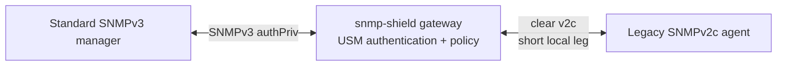

# USM gateway (one box, protects the legacy agent)

A single proxy in front of a legacy v2c-only agent. Standard SNMPv3
managers (net-snmp, Zabbix, PRTG, anything that speaks USM) authenticate
directly to the gateway — no second proxy, no tunnel.



This is the deployment for one box per site: the gateway **is** the
agent's security gate — unauthenticated or wrongly-authenticated traffic
never reaches the legacy device (clear v2c arriving on the front leg is
rejected by design).

## 1. Run it

```bash
snmp-shield gateway \
  --security usm-gateway \
  --listen :161 \
  --agent 127.0.0.1:161 \
  --auth-pass myauthpass --priv-pass myprivpass \
  --community public \
  --trap-listen :162 \
  --trap-sink <manager-ip>:162
```

- `--listen` — the v3 front leg (managers poll here).
- `--agent` — the legacy agent; `127.0.0.1:161` when the gateway runs on
  the agent host itself.
- `--auth-pass`/`--priv-pass` — creates the USM user `proxy` (SHA auth +
  AES privacy). Managers configure the same credentials.
- `--trap-listen` — optional: the legacy network fires clear traps and
  informs here.
- `--trap-sink` — the manager's v3 trap receiver; clear traps and
  informs accepted on `--trap-listen` are wrapped into authenticated v3
  USM notifications toward it (informs confirmed: the manager's
  acknowledgment is relayed back to the device).
- Either leg pair can be used alone: notification-only (this section
  only) secures a manager leg with no request path — see
  [gateway-notifications-only](gateway-notifications-only.md).

**Scale notes:** any number of managers can poll the gateway
concurrently — each request is correlated independently (the engine and
the user database are shared, which is correct per RFC 3414: every
manager discovers the same authoritative engine). Notifications, on the
other hand, go to a **single** `--trap-sink`; if a second manager needs
the trap stream, deploy a second gateway instance for it.

## 2. Point the manager at the gateway

Any standard manager with USM user `proxy`, auth SHA, priv AES:

```bash
snmpget -v3 -l authPriv -u proxy -a SHA -A myauthpass -x AES -X myprivpass \
  <gateway-ip> sysDescr.0
```

## 3. Multiple users

Flags mode creates the single user `proxy`. For more users, use the
config file (`configs/gateway-usm.yaml`):

```yaml
gateway:
  listen_addr: ":161"
  agent_addr: "127.0.0.1:161"
security:
  mode: usm-gateway
  engine_store: /var/lib/snmp-shield/engine.json
  users:
    - name: noc
      auth_protocol: sha
      auth_passphrase: ...
      priv_protocol: aes
      priv_passphrase: ...
    - name: auditor
      auth_protocol: sha256
      auth_passphrase: ...
      priv_protocol: aes256
      priv_passphrase: ...
```

The engine boots store is REQUIRED (anti-rollback): point
`security.engine_store` at persistent storage (systemd's
`StateDirectory` covers this, see `deploy/`).

## 4. Verify

```bash
# environment check: SNMP GET to the legacy agent behind the gateway:
snmp-shield selftest --role gateway --security usm-gateway \
  --listen :161 --agent 127.0.0.1:161 --auth-pass myauthpass --priv-pass myprivpass
```

## Protection semantics

- Clear v1/v2c on the front leg (`--listen`): **rejected** — that
  rejection is the protection.
- Wrong user / wrong credentials: rejected with RFC 3414 Reports.
- Replay / stale engine boots: rejected (persisted engine state).

## Hardening options

- **Notification filtering** — the legacy network fires all kinds of
  traps; drop the uninteresting ones before they reach the manager:

  ```bash
  snmp-shield gateway --trap-listen :162 \
    --filter-oid 1.3.6.1.4.1.99 --filter-action deny ...
  ```

  `--filter-oid` is an OID prefix (repeatable, arc-boundary match),
  `--filter-action` is `allow` or `deny`. In YAML:
  `notifications.filter` (see `configs/gateway-usm.yaml`).

- **SNMP metrics interface** — expose the proxy's own health over SNMP
  (optional, all roles): `--metrics-snmp-listen <ip:port>` serves a
  read-only SNMPv2c health MIB (GET/GETNEXT: identity, tunnel state,
  counters) and `--metrics-snmp-trap-sink <ip:port>` emits v2c traps on
  tunnel lifecycle changes (up/down, HA failover). `--metrics-snmp-base-oid`
  (default `.1.3.6.1.4.1.58427.1`) and `--metrics-snmp-community`
  (default "public") apply to both. Prometheus (`--metrics-addr`) stays
  available alongside. In YAML: `metrics:`.
- **PSK ciphersuite** — not applicable here (the front leg is plain
  UDP; there is no tunnel PSK). Only relevant for the two-proxy
  deployments.
