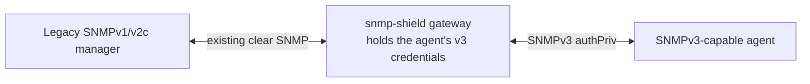

# Manager-gateway (one box, the legacy manager keeps talking v2c)

A single proxy in front of a legacy manager/NMS that only speaks clear
v1/v2c — the agent behind it is v3-capable. The gateway talks clear SNMP
to the legacy manager and re-issues everything as authenticated,
encrypted SNMPv3 USM authPriv toward the real agent — no second proxy,
no tunnel, and the legacy manager never needs to learn SNMPv3.



This is the deployment when you cannot touch the manager (it cannot do
SNMPv3) but the wire between the proxy and the agent must be secured:
requests are signed and encrypted end to end, the agent's v3 credentials
never leave the proxy, and the agent-side leg is protected — v2c traffic
never crosses it.

## 1. Run it

```bash
snmp-shield gateway \
  --security usm-manager-gateway \
  --listen :161 \
  --agent 127.0.0.1:8161 \
  --user authPrivUser \
  --auth-pass myagentauth --priv-pass myagentpriv \
  --trap-listen :162 \
  --trap-sink <manager-ip>:162
```

- `--listen` — the clear v1/v2c front leg (the legacy manager polls
  here).
- `--agent` — the real v3-capable agent.
- `--user`/`--auth-pass`/`--priv-pass` — the **agent's** v3 USM user
  (SHA auth + AES privacy by default). The gateway authenticates toward
  the agent as this user; the legacy manager never sees the credentials.
- `--trap-listen` — optional: the agent fires v3 traps/informs here.
- `--trap-sink` — the legacy manager's trap receiver; agent notifications
  accepted on `--trap-listen` are verified, decrypted and relayed as
  clear v2c traps (informs are confirmed by the proxy itself).

**Scale notes:** any number of legacy managers can poll the gateway
concurrently — each request is correlated independently (the manager's
original req-id, community and address are remembered per request). The
v3 **agent** side is singular: one `--agent` per instance. If a second
manager needs the trap stream, deploy a second gateway instance for it.

## 2. Point the legacy manager at the gateway

Any v1/v2c manager — no v3 configuration needed:

```bash
snmpget -v2c -c public <gateway-ip> sysDescr.0
```

The community from the manager's request is accepted and echoed back on
the response; the proxy re-issues the request as an authenticated v3
authPriv GET toward the agent (RFC 3414 engine discovery, signed +
encrypted scopedPDU), verifies and decrypts the response and strips it
back to the clear v2c shape the manager expects.

## 3. Multiple users / config file

Flags mode configures a single agent-side user. For more control, use
the config file (`configs/gateway-manager-gateway.yaml`):

```yaml
gateway:
  listen_addr: ":161"
  agent_addr: "127.0.0.1:8161"
security:
  mode: usm-manager-gateway
  users:
    - name: authPrivUser
      auth_protocol: sha
      auth_passphrase: ...
      priv_protocol: aes
      priv_passphrase: ...
```

No `engine_store` is needed in this mode: the **agent** is the
authoritative SNMP engine — the gateway performs RFC 3414 discovery
against it and follows the agent's engineBoots/engineTime (re-syncing on
the agent's Reports, so agent reboots are handled).

## 4. Verify

```bash
# environment check: RFC 3414 discovery + authenticated GET to the agent:
snmp-shield selftest --role gateway --security usm-manager-gateway \
  --listen :161 --agent 127.0.0.1:8161 --user authPrivUser \
  --auth-pass myagentauth --priv-pass myagentpriv
```

## Protection semantics

- The proxy–agent leg is **authenticated and encrypted** (USM authPriv);
  the legacy manager's community string never crosses it.
- v3 datagrams on the manager front leg (`--listen`): **ignored** — the
  front leg is v1/v2c by design.
- Agent responses are digest-verified and decrypted before anything is
  relayed to the manager; tampered traffic is dropped.

## Hardening options

- **Notification filtering** — the agent fires all kinds of traps; drop
  the uninteresting ones before they reach the legacy manager:

  ```bash
  snmp-shield gateway --trap-listen :162 \
    --filter-oid 1.3.6.1.4.1.99 --filter-action deny ...
  ```

  `--filter-oid` is an OID prefix (repeatable, arc-boundary match),
  `--filter-action` is `allow` or `deny`. In YAML:
  `notifications.filter` (see `configs/gateway-manager-gateway.yaml`).

- **SNMP metrics interface** — expose the proxy's own health over SNMP
  (optional, all roles): `--metrics-snmp-listen <ip:port>` serves a
  read-only SNMPv2c health MIB (GET/GETNEXT: identity, tunnel state,
  counters) and `--metrics-snmp-trap-sink <ip:port>` emits v2c traps on
  tunnel lifecycle changes (up/down, HA failover). `--metrics-snmp-base-oid`
  (default `.1.3.6.1.4.1.58427.1`) and `--metrics-snmp-community`
  (default "public") apply to both. Prometheus (`--metrics-addr`) stays
  available alongside. In YAML: `metrics:`.
- **PSK ciphersuite** — not applicable here (there is no tunnel PSK).
  Only relevant for the two-proxy deployments.
